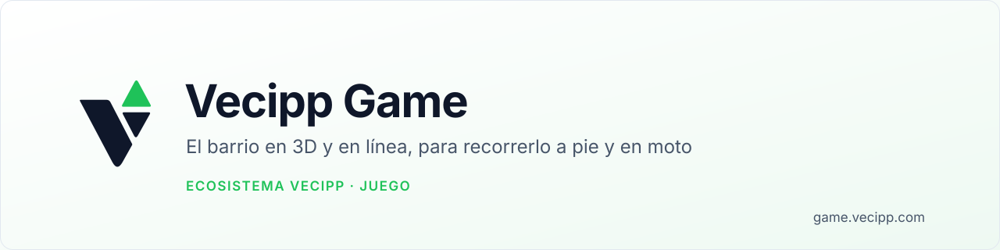

<!-- vecipp:cabecera — generado por aplicar-marca: no editar a mano, se regenera -->

  <picture>
    <source media="(prefers-color-scheme: dark)" srcset=".github/assets/banner-oscuro.svg">
    
  </picture>

  
  
  
  
  
  

  <a href="https://vecipp.com"><b>vecipp.com</b></a> ·
  <a href="https://github.com/Vecipp/Vecipp-Negocio"><b>Vecipp Negocio</b></a> ·
  <a href="https://github.com/Vecipp/Vecipp-Barrio"><b>Vecipp Barrio</b></a> ·
  <a href="https://github.com/Vecipp/Vecipp-IA-Releases"><b>Vecipp IA</b></a> ·
  <a href="https://github.com/Vecipp/Vecipp-Game"><b>Vecipp Game</b></a>

<!-- /vecipp:cabecera -->

## Vecipp Game, el barrio en 3D y en línea

**Vecipp Game** es el mundo de Vecipp para **jugar en el barrio de verdad**. Empieza por Córdoba, un pueblo del Quindío,
Colombia, y su Parque José María Córdoba, hecho igual al real: su ubicación, su forma, sus colores, sus subidas y bajadas
y sus negocios con su nombre. Se recorre a pie o en moto, con controles táctiles como los de los grandes juegos de
celular, y está pensado para que los vecinos se encuentren en línea desde cualquier lugar. Un juego hecho en Colombia,
con ingeniería de clase mundial, para que cada pueblo de Latinoamérica pueda verse en una pantalla.

> Vecipp Game es parte de **Vecipp**, un ecosistema tecnológico latinoamericano que reúne en una sola cuenta la
> gestión de los negocios, la vida del barrio y la inteligencia artificial.

## Estado

Vecipp Game está **en desarrollo**. Su primera versión corre en Android; iOS y el modo en línea vienen en camino.
La meta es Google Play y la App Store, y abrirlo también desde «Entretenimiento» en Vecipp Barrio.

## Qué puedes hacer

### 🏞️ El pueblo de verdad
- Recorre el Parque José María Córdoba y sus calles tal como son: la iglesia, la alcaldía, los andenes, las gradas y
  las pendientes reales.
- Los negocios del parque con su nombre y su aviso, edificio por edificio, hechos a partir de fotos del lugar.

### 🛵 A pie y en moto
- Camina, corre y salta con un joystick y botones táctiles, con varios dedos a la vez.
- Súbete a la moto y recorre el pueblo con el sonido del motor.
- Escoge el nivel de gráficas y los cuadros por segundo según tu celular.

### 🤝 Con los vecinos (en camino)
- Entra con tu cuenta de Vecipp y encuéntrate con tus vecinos en el mismo parque, desde cualquier lugar.
- Un solo juego con varios mundos: cada pueblo nuevo es un mundo más, sin instalar otra app.
- Más adelante, los negocios de Vecipp dentro del juego: ver su catálogo y pedir sin salir del barrio.

## Por qué Vecipp Game

- **Tu pueblo, en la pantalla.** No es una ciudad inventada: es el lugar donde vives o del que vienes, para recorrerlo
  y compartirlo.
- **Fluido en el celular de todos los días.** Pensado desde el primer día para celulares de gama media, con niveles de
  gráficas para cada teléfono.
- **Una sola cuenta.** La misma cuenta de Vecipp para el barrio, los negocios y el juego.
- **Hecho para crecer.** Cada pueblo, cada negocio y cada modo de juego nuevo es contenido, no otra app: el juego
  crece sin hacerse pesado.
- **Tus datos son tuyos.** En el juego los demás ven tu nombre y tu foto, nada más.

## Tecnología

Vecipp Game está construido en **Unity 6** con **C#**: un solo proyecto para Android, iOS y su servidor en línea.
Su mundo se modela en 3D a partir de fotos, mapas y alturas reales del lugar, y se carga por zonas para que el juego
corra liviano en el celular.

## Nuestra historia

Vecipp nació en un pueblo de Colombia, lejos de los grandes centros tecnológicos del mundo, con un sueño más grande que
el lugar donde empezó. Sus fundadores, los ingenieros de software **Yilmer Carrillo Diaz** y **Yeferson Carrillo
Diaz**, diseñaron y desarrollaron el ecosistema completo. Crecieron viendo de cerca el día a día de los comerciantes,
los tenderos y los trabajadores de su región, y de ahí salió la pregunta que todavía mueve a Vecipp: **¿por qué la
mejor tecnología del mundo tiene que nacer siempre en otro lugar?**

La respuesta fue construirla. Primero llegó el ecosistema para el negocio; después el barrio, para conectar a vecinos,
tiendas y domiciliarios. Vecipp Game nace en ese mismo pueblo, para llevarlo a la pantalla de cualquiera que quiera
conocerlo. Cada línea de código de Vecipp está escrita desde Latinoamérica, para el mundo.

## Misión y visión

**Misión.** Hacerle la vida más fácil a las personas y a los negocios con tecnología de clase mundial que cualquiera
pueda usar: sencilla para quien la usa, robusta por dentro y conectada como un solo ecosistema.

**Visión.** Ser el ecosistema tecnológico de referencia de Latinoamérica y llegar a millones de usuarios en el mundo,
demostrando que la innovación que cambia industrias también nace en nuestros países. Crear lo que todavía no existe.

## Enlaces

**Vecipp Game**
- Sitio oficial: [vecipp.com](https://vecipp.com)
- Centro de ayuda: [ayuda.vecipp.com](https://ayuda.vecipp.com)

**Los mundos de Vecipp**
- Vecipp Negocio: [github.com/Vecipp/Vecipp-Negocio](https://github.com/Vecipp/Vecipp-Negocio)
- Vecipp Barrio: [github.com/Vecipp/Vecipp-Barrio](https://github.com/Vecipp/Vecipp-Barrio)
- Vecipp IA: [github.com/Vecipp/Vecipp-IA-Releases](https://github.com/Vecipp/Vecipp-IA-Releases)
- Vecipp Game: [github.com/Vecipp/Vecipp-Game](https://github.com/Vecipp/Vecipp-Game)

<!-- vecipp:pie — generado por aplicar-marca: no editar a mano, se regenera -->
---

## 🌎 Sobre Vecipp

**Vecipp** es un ecosistema tecnológico latinoamericano que reúne en una sola cuenta la gestión de los negocios, la vida
del barrio y la inteligencia artificial. Nació en un pueblo de Colombia con un sueño más grande que el lugar donde
empezó: demostrar que desde Latinoamérica se crea tecnología de clase mundial, y llegar a millones de personas
haciéndoles la vida más fácil. [Nuestra historia, misión y visión](https://github.com/Vecipp/Vecipp-Negocio#nuestra-historia).

| Documento | Para qué |
|---|---|
| [`CONTRIBUTING.md`](CONTRIBUTING.md) | Cómo se trabaja en este repositorio |
| [`SECURITY.md`](SECURITY.md) | Cómo reportar una vulnerabilidad |
| [`CODE_OF_CONDUCT.md`](CODE_OF_CONDUCT.md) | Código de conducta |
| [`LICENSE.md`](LICENSE.md) | Licencia |

  <picture>
    <source media="(prefers-color-scheme: dark)" srcset=".github/assets/logo-vecipp-blanco.svg">
    
  </picture> 
  Diseñado y desarrollado por los ingenieros de software <b>Yilmer Carrillo Diaz</b> y <b>Yeferson Carrillo Diaz</b> · © 2026 · Hecho en Colombia 🇨🇴 para Latinoamérica y el mundo

<!-- /vecipp:pie -->
